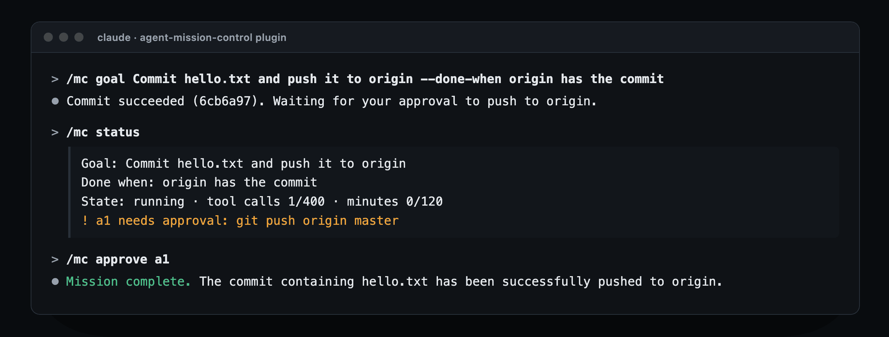

# Agent Mission Control

Keep long Claude Code runs on track, without sitting at the keyboard. Give the run a goal with a
finish line, cap what it can spend, hold risky commands until you say GO, and steer it from the
chat with `/mc`.

- **A goal with a finish line.** While a goal is active, a Stop hook keeps the run going until
  the agent marks it done (it's told to only when your "done when" holds). It lets the run stop
  when it's waiting on you, out of budget, or stuck, so it can't loop.
- **Budgets with teeth.** Cap tool calls, minutes and automatic continues. When one runs out,
  every tool call is refused and the agent is told to wrap up. A new goal starts a fresh budget.
- **GO / NO-GO for risky commands.** `git push`, `npm publish`, `rm -rf`, or any pattern you
  add, is held until you approve it. The agent works on other things or stops, then runs exactly
  the command you approved.
- **Questions and notes mid-run.** The agent asks with `mc ask`. You answer with `/mc answer`,
  and your notes reach it between tool calls. No restart.

One JSON file of state per project. Zero dependencies. Needs Node.js 18.17+ on your `PATH`.
Tested on macOS with Claude Code 2.1.287; Linux and Windows aren't tested yet.

## Install

In Claude Code:

```
/plugin marketplace add long-run-labs/agent-mission-control
/plugin install agent-mission-control@long-run-labs
```

The plugin does nothing in a project until you give it a goal there.

## Use it

Start a mission in any project by typing, in the chat:

```
/mc goal Ship the CSV export --done-when tests pass and a PR is open
```



Then work as usual. Steer with `/mc` whenever you like:

```
/mc status                          goal, budget, open questions, held commands
/mc approve a1                      or: /mc deny a1 not on Fridays
/mc answer q2 Postgres
/mc say use the staging DB only     a note for the agent
/mc pause                           /mc resume
/mc set maxToolCalls 2000           /mc set maxMinutes 600
/mc set requireApproval git push, npm publish, terraform apply
/mc reset-budget                    /mc done
/mc help
```

When the agent is waiting on you (a held command or a blocking question), your `/mc approve` or
`/mc answer` lets it carry on right away. A `/mc` typed while the agent is working waits until
the run stops. To send it sooner, press Esc first: that stops the current step, and the agent
picks up again after your `/mc`. Or use `mc` in a terminal (below), which acts at the agent's next
tool call without interrupting it. If `/mc` clashes with another command you have, type
`/agent-mission-control:mc` instead.

### Three ways people use it

1. **An overnight run.** `/mc goal Migrate the API tests to Vitest --done-when npm test passes`,
   then `/mc set maxMinutes 600` and `/mc set maxToolCalls 2000`. The agent keeps going until the
   tests pass or the budget runs out, and anything matching `git push` waits for you in the morning.
2. **A risky refactor with a seatbelt.** `/mc set requireApproval git push, rm -rf, prisma migrate`.
   The agent stops at each matching command and runs it only after `/mc approve`.
3. **Steering without restarting.** Mid-run, press Esc and type
   `/mc say keep the old endpoint working until v3`, or run `mc say …` in a terminal so nothing
   is interrupted. The agent gets the note and carries on, and `/mc status` shows what it's doing
   and what's next.

### From a terminal

A note sent from a second terminal reaches the agent mid-run, after its next tool call. `/mc help`
prints the exact command for your machine; from the project folder it looks like
`node "<plugin folder>/cli/mc.mjs" say "use the staging DB only"`. The plugin folder changes with
each plugin update, so run `/mc help` again after one.

## How it works

| Hook event | What it does |
|---|---|
| `SessionStart` | Gives the agent the mission brief: goal, budget, open questions, recent log, protocol |
| `UserPromptExpansion` | Applies the `/mc` commands you type |
| `UserPromptSubmit` | Passes along anything new from you |
| `PreToolUse` | Refuses tools while paused or over budget; holds commands that need a GO; keeps the agent out of `.mission/` |
| `PostToolUse`, `PostToolUseFailure` | Counts the call; delivers your notes, answers and approval decisions |
| `Stop` | While a goal is active, keeps the run going until it's done, unless it's waiting on you, out of budget, or stuck |

The agent reports with its own `mc` commands (`now`, `log`, `ask`, `reply`, `done`). It can't run
yours: `approve`, `resume`, `set`, `reset-budget` and the rest are refused when it tries, and so
is any command chained onto `mc`. A `/mc` only counts when a person types it in a session they're attending. The usual ways around
that are refused: a nested `claude -p "/mc …"`, a scheduled `/mc`, a script that carries one. And
starting any nested `claude` mid-mission waits for your GO. Like the approval patterns, this is a
seatbelt, not a sandbox: an agent that deliberately disguises a command can get past it. The
skill tells it not to, and Claude Code's own permissions still apply. If the state file can't be read, tools are refused with the
reason instead of the checks silently switching off.

Approval patterns match the whitespace-collapsed command, case-insensitively; `*` matches
anything. They're a seatbelt, not a sandbox: Claude Code's own permission system still applies.

## With Claude Code's /goal

Claude Code's built-in `/goal` keeps a session going until a condition holds. Mission Control has
its own finish line, so you don't need both, and it adds what `/goal` doesn't: commands that wait
for your GO while the agent keeps working, budgets that refuse tools once they're spent, and notes
and answers mid-run. If you do run both, each keeps the run going until its own condition holds.

## What it runs, stores and sends

- **Runs:** one Node.js script, `hooks/mission-hook.mjs`, on seven Claude Code hook events, and
  `cli/mc.mjs` when the agent or you run `mc`. Nothing else, and nothing is downloaded.
- **Stores:** `.mission/mission.json` in your project (goal, controls, status, questions, notes,
  approvals and a log) and a `.gitignore` beside it, so it stays out of commits. Nothing is stored
  anywhere else.
- **Sends:** nothing. This plugin makes no network connections and collects no data.
- **Adds to Claude's context:** the brief at session start, and your notes and decisions after
  tool calls, only in projects where you've set a mission; and the result of each `/mc` you type.

Remove a project's mission by deleting its `.mission/` folder. Uninstall the plugin with
`/plugin uninstall agent-mission-control@long-run-labs`.

## Install without the plugin system

```bash
git clone https://github.com/long-run-labs/agent-mission-control
node agent-mission-control/install.mjs /path/to/your/project
```

This copies the runtime to `<project>/.mission/` (git-ignored), registers the hook for seven events
in `<project>/.claude/settings.local.json` (existing entries kept, original saved once as `.bak`,
kept out of commits through `.git/info/exclude`), and adds the skills, `/mc` included. Add
`--shared` to use the committed `.claude/settings.json` instead, and commit `.mission/` too. In
a project installed this way, that copy is in charge and the plugin stays out of the way.

## Support

Questions, bugs and ideas: [GitHub Issues](https://github.com/long-run-labs/agent-mission-control/issues).
`npm test` runs the end-to-end checks against temporary projects.

## The full kit

A paid kit with a live console and phone alerts used to be sold separately. It is no longer sold.
This free plugin works on its own.

## License

MIT
